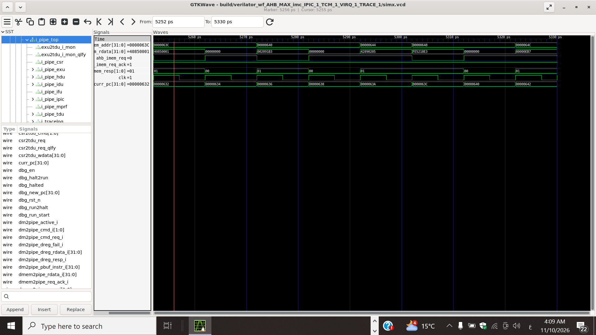

# Лабораторная работа 3 (дополнительное задание): анализ конвейера SCR1 — команда `sll`

**Студент:** Хассани Уссама, группа P4119, Университет ИТМО  
**Дисциплина:** Организация вычислительных систем (SoC), вариант 10  
**Репозиторий / ветка:** `github.com/oussamahassani2023/scr1`, ветка `lab3_scr1_pipe_analys`

## 1. Цель

Изучить работу конвейера SCR1 на примере одной команды (`sll`), показать её выполнение на временной диаграмме и доработать тестбенч несинтезируемым монитором, который обнаруживает команду и выводит отладочную информацию (PC).

## 2. Исследуемая команда

`sll rd, rs1, rs2` — логический сдвиг влево: `rd = rs1 << rs2[4:0]`, справа вдвигаются нули.

| 31..25  | 24..20 | 19..15 | 14..12 | 11..7 | 6..0    |
|---------|--------|--------|--------|-------|---------|
| 0000000 | rs2    | rs1    | 001    | rd    | 0110011 |

## 3. Конвейер SCR1

1. **IFU** — формирует запрос `imem_req` с адресом `imem_addr`, получает от памяти инструкций ответ `imem_resp` и данные `imem_rdata`.
2. **IDU** — декодирует команду, читает `rs1` и `rs2` из регистрового файла (MPRF).
3. **EXU/IALU** — выполняет сдвиг; сигнал `curr_pc` соответствует PC команды на стадии Execution.
4. **Write-back** — результат записывается в `rd` через порт записи MPRF.

На диаграмме показаны сигналы выборки команды (IFU) и `curr_pc` (стадия Execution).

## 4. Порядок выполнения

1. Создана ветка от `master`: `git checkout -b lab3_scr1_pipe_analys`.
2. Список тестов в `sim/tests/riscv_isa/rv32_tests.inc` сокращён до одного теста: `isa/rv32ui/sll.S`.
3. Запуск с записью временной диаграммы: `make run_verilator_wf TARGETS="riscv_isa" TRACE=1`.
4. В GTKWave (`simx.vcd`) выведены сигналы: `clk`, `curr_pc`, `ahb_imem_req`, `ahb_imem_req_ack`, `ahb_imem_addr`, `ahb_imem_resp`, `ahb_imem_rdata`.
5. В тестбенч `src/tb/scr1_top_tb_ahb.sv` добавлен модуль `scr1_tb_log_cmd` и его экземпляр `i_tb_log_cmd`.

## 5. Монитор (несинтезируемый)

Модуль `scr1_tb_log_cmd` подключён к интерфейсу памяти инструкций `i_top.i_imem_ahb`.

- Адрес каждого принятого запроса (`imem_req && imem_req_ack`) сохраняется в небольшую FIFO.
- Когда память отвечает (`imem_resp != 2'b00`), из FIFO извлекается адрес, а возвращённое слово декодируется: `opcode = 0110011`, `funct3 = 001`, `funct7 = 0000000`.
- Для команды `sll` выводится сообщение:

```
Detected command: SLL | PC = 0x........ | instr = 0x........
```

Адрес хранится в FIFO, потому что ответ памяти приходит позже запроса, и к этому моменту `imem_addr` уже относится к следующей выборке (см. раздел 7).

## 6. Результаты

- Временная диаграмма: `report/wave_sll.png`
- Вывод монитора: `report/log_sll.txt`
- Результат теста: `sll.hex — build OK, simulation PASS`, `Summary: 1/1 tests passed`.
- Адреса PC, выведенные монитором (например, `0x63c`, `0x668`, `0x678`), совпали с адресами команд `sll` в дизассемблере `sll.dump`.



## 7. Наблюдения по диаграмме

- В момент 5272 ps `imem_resp = 01` и `imem_rdata = 0x002091B3` (`sll gp,ra,sp`): команда пришла из памяти инструкций, монитор выводит `PC = 0x0000063c`.
- В тот же момент `imem_addr` уже равен `0x00000640` (следующая выборка). Поэтому монитор хранит адреса запросов в FIFO, а не использует текущее значение `imem_addr`.
- Сигнал `curr_pc` (стадия Execution) достигает `0x0000063C` в момент 5302 ps, то есть через 3 такта (30 ps) после получения слова из памяти.

## 8. Вывод

Команда `sll` прослежена от выборки из памяти инструкций до стадии выполнения (`curr_pc`). Монитор обнаруживает её на интерфейсе выборки и выводит PC.

Ограничения: обнаружение происходит на стадии выборки, поэтому команды, которые были выбраны, но затем отброшены (после перехода или исключения), также могут быть выведены. Кроме того, 32-битная команда, расположенная не по границе слова при включённом расширении C, может быть не обнаружена.
